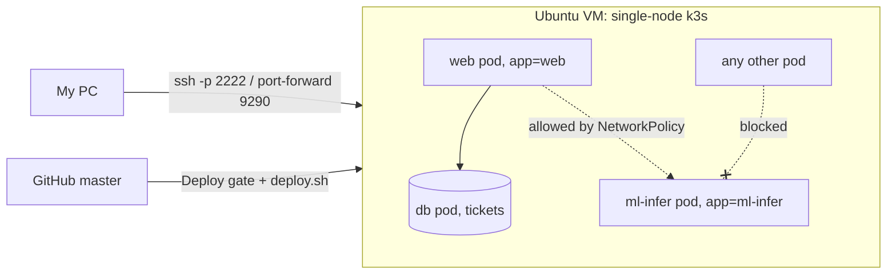

# ML & AI Track: Architecture (Week 11 draft)

## The problem in my own words

Priya's six Support Desk agents read every new ticket by hand and guess how urgent it is, because a ticket only has a title and a status. So a serious incident can sit unread behind ten routine ones, and that's what has been hurting Dana's customer promises. Done, for me, means a small service that suggests a category and a severity (with a confidence) from the title, that is measured against a dumb baseline, and that runs in my k3s cluster behind its own NetworkPolicy. It's advice for a person, never an automatic action.

## Data decision: labels live in files, not in the database

I'm keeping the labeled data in `capstone/ml-ai/data/incidents.csv` instead of adding `category` and `severity` columns to the `tickets` table, at least for now. A few reasons:

- The training data has to be synthetic (Elena's rule), so I'd rather keep it completely separate from the live `tickets` table instead of mixing fake rows into the app's database.
- No schema change has to go through `db.tf` and the deploy pipeline this week, so the app and the database stay exactly as they were after Week 10.
- The file can be rebuilt any time from the seed (`generate_data.py --seed 4031`), and the same seed gives the same file byte for byte.

If I end up having the app call the service when a ticket is created (the Make It Yours idea), that's when I'd add the columns.

## How the labels are made

All rows are made up by `generate_data.py`. Nothing comes from real people, customers, or a downloaded dataset.

- **Category (5):** Network, Devices, Access, Vehicles, Shipments. The category is whatever the title is mainly about (wifi or a VPN is Network, a handheld scanner is Devices, a badge reader is Access, and so on).
- **Severity (4):** Low, Medium, High, Critical, picked from the problem words in the title ("question" or "minor typo" is Low, "is slow" is Medium, "won't connect" is High, "down for the whole depot" is Critical). Most incidents aren't emergencies, so Critical is only about 10%.
- **Making it harder on purpose:** about 12% of titles also mention a second subject ("..., maybe the wifi too"), and about 7% of rows get a changed category and 7% a changed severity, because real people mislabel tickets too.
- Default size is 6,000 rows over 90 days, with more incidents during day shifts.

Because I wrote the rules, a high test score mostly tells me the model learned my rules. It does not prove it would work on real Harborlight incidents. In Week 13 I plan to add a harder test set with wording the model never saw.

## Model

- 80/20 train/test split, stratified by severity, `random_state=4031`. The 20% test rows are never used for training.
- Baseline: `DummyClassifier(strategy="most_frequent")`, one per target.
- Model: `TfidfVectorizer(ngram_range=(1, 2), min_df=2)` + `LogisticRegression`, one pipeline per target, saved with joblib to `models/`.
- Results go to `metrics.json` (accuracy and macro F1 for the baseline and the model, plus the dataset hash).

## Planned layout (Week 12)

The inference service will be a small Flask app that loads both models once at startup, built as `ml-ai-infer:v1`, imported into k3s, and deployed through `week-5/ml-infer.tf` with memory requests and limits and a NetworkPolicy that only lets `app: web` in.
